# TecnoMarket
 
Proyecto de fin de ciclo del ciclo formativo de grado superior en Desarrollo de Aplicaciones Web (DAW).
 
> **Estado del proyecto:** TecnoMarket **ya no está desplegado**. Este repositorio conserva el código, la documentación y las capturas de pantalla.
 
## Descripción
 
TecnoMarket es una tienda de electrónica que desarrollé como proyecto final de mi ciclo de DAW. Está construida con una API REST en Symfony, un frontend en Vue y una base de datos relacional MariaDB. Permite a los usuarios navegar por el catálogo, buscar productos y comprarlos.
 
Además de las funciones básicas de compra, incluye un panel de administración con el que se puede:
 
- Añadir, modificar y eliminar productos.
- Gestionar usuarios, permitiendo activar y desactivar cuentas y habilitar y deshabilitar usuarios como administradores.
- Gestionar pedidos, incluyendo la actualización de su estado.
- Valorar los productos con puntuación y comentarios.
## Funcionamiento de la aplicación
 
A continuación se muestra, con capturas de pantalla, cómo funciona la aplicación.
 
**Registro e inicio de sesión:**
 
- Accede al modal de registro para crear una cuenta.
- Inicia sesión con tu nueva cuenta.
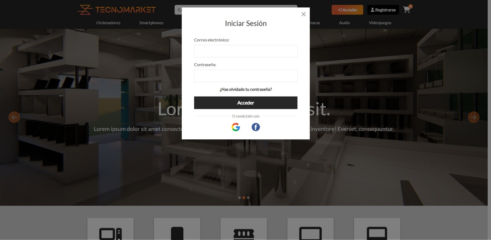
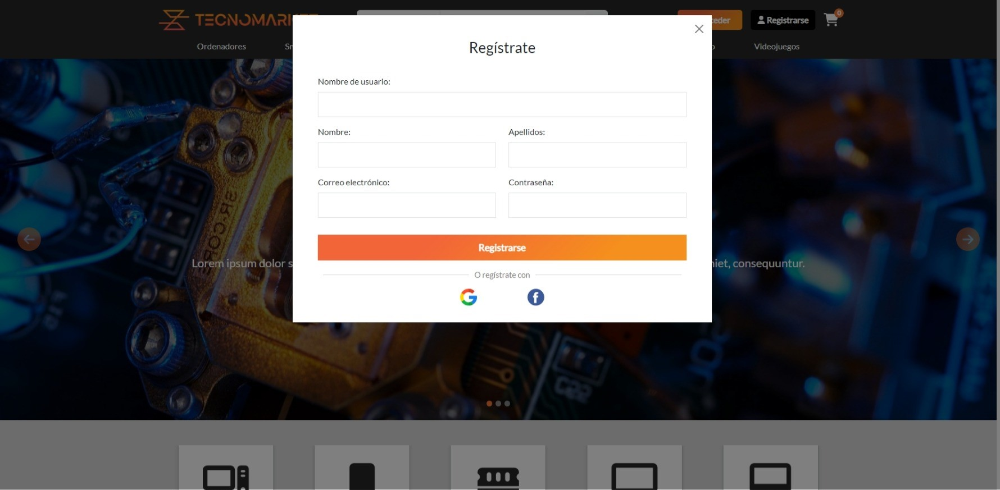
 
**Exploración de productos:**
 
- Navega por las diferentes categorías de productos (o desde la barra de navegación o desde la barra lateral en caso de los dispositivos móviles).
- Utiliza la barra de búsqueda para encontrar productos concretos.
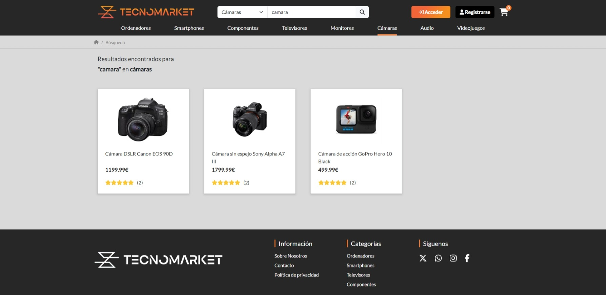
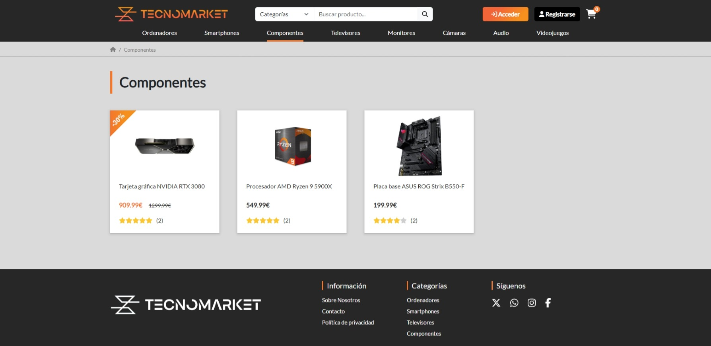
 
**Detalles del producto:**
 
- Haz clic en cualquier producto para ver un producto en detalle.
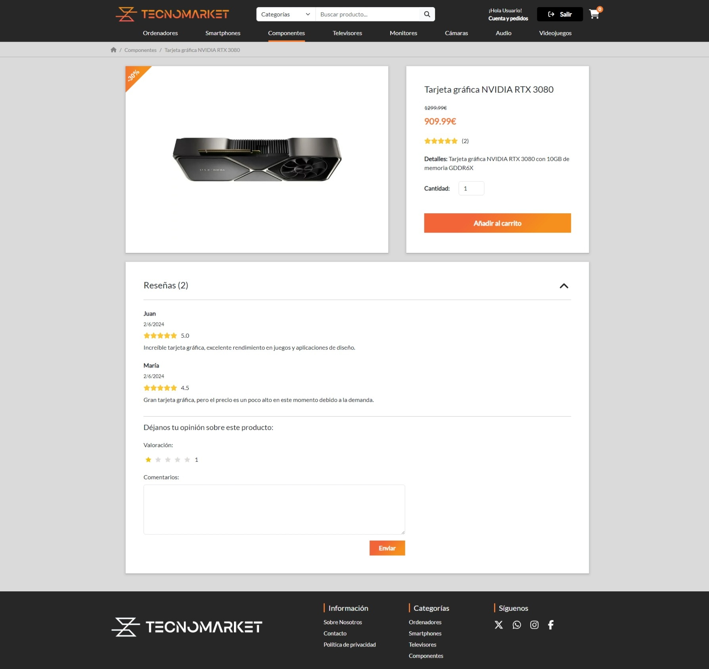
 
**Añadir al carrito:**
 
- Selecciona la cantidad deseada y añade el producto a tu carrito.
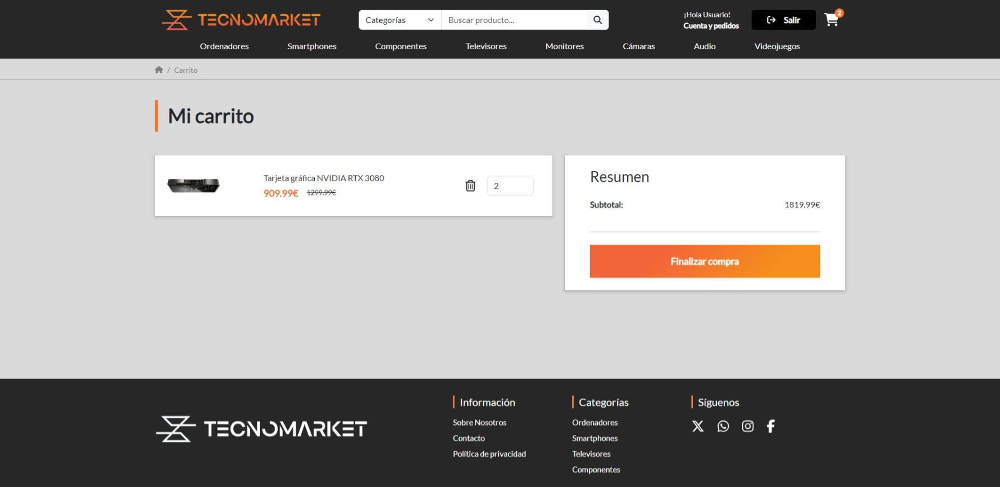
 
**Proceso de compra:**
 
- Accede a tu carrito para revisar los productos seleccionados.
- Accede a la pasarela de pago pulsando el botón de "finalizar compra".
- Continúa con el proceso de compra proporcionando la información necesaria para el envío y pago.
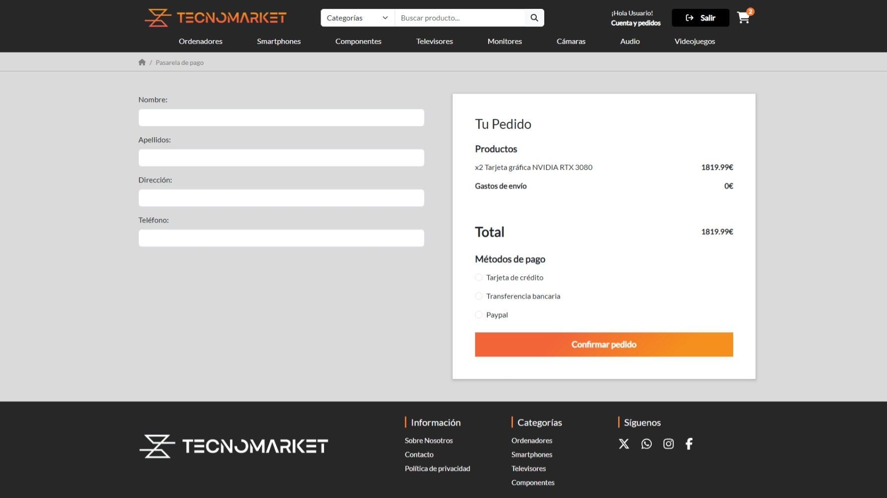
 
**Datos de usuario**
 
- Accede a tu perfil para revisar tus datos y consultar tus pedidos.
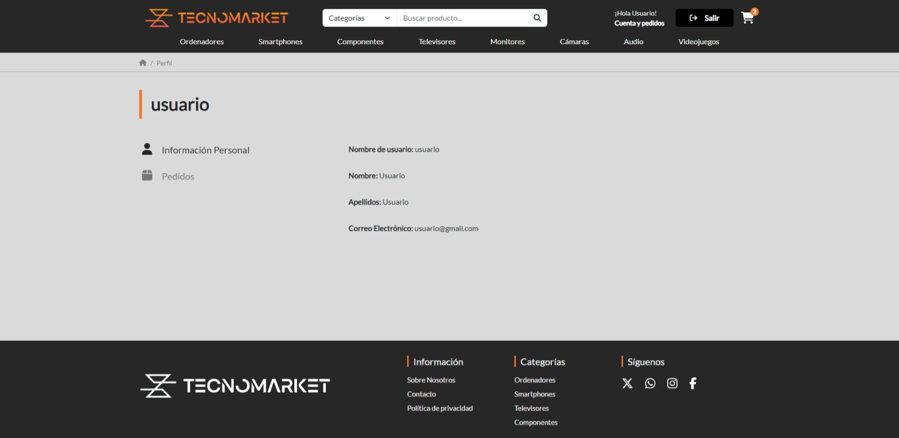
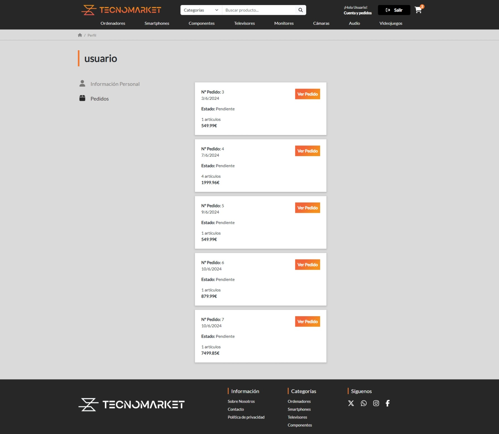
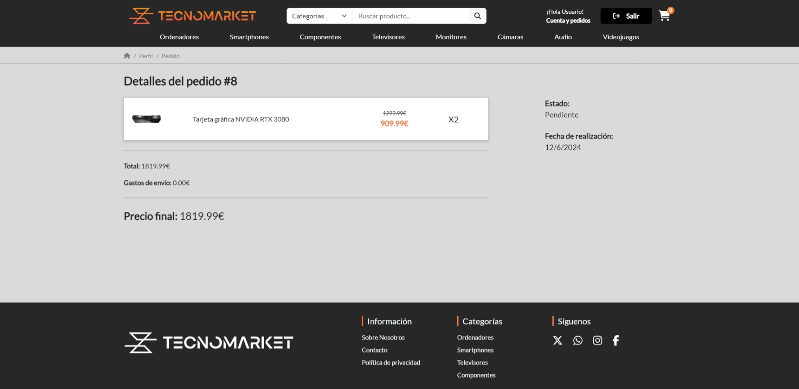
 
**Gestión de inventario (administradores):**
 
- Añadir, modificar y eliminar productos desde el panel de administración.
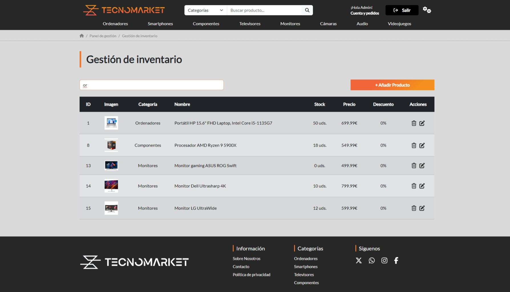
 
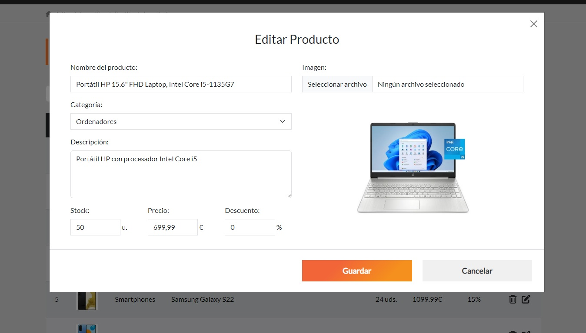
 
**Gestión de usuarios (administradores):**
 
- Desactivar cuentas de usuarios o habilitar usuarios como administradores.
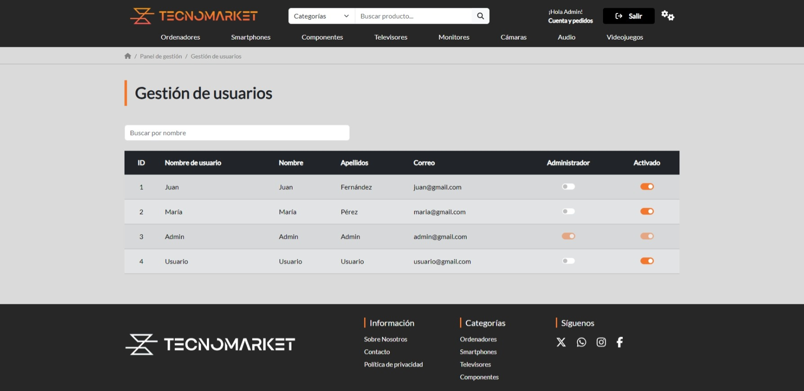
 
**Gestión de pedidos (administradores):**
 
- Cambiar el estado de los pedidos según el proceso de gestión.
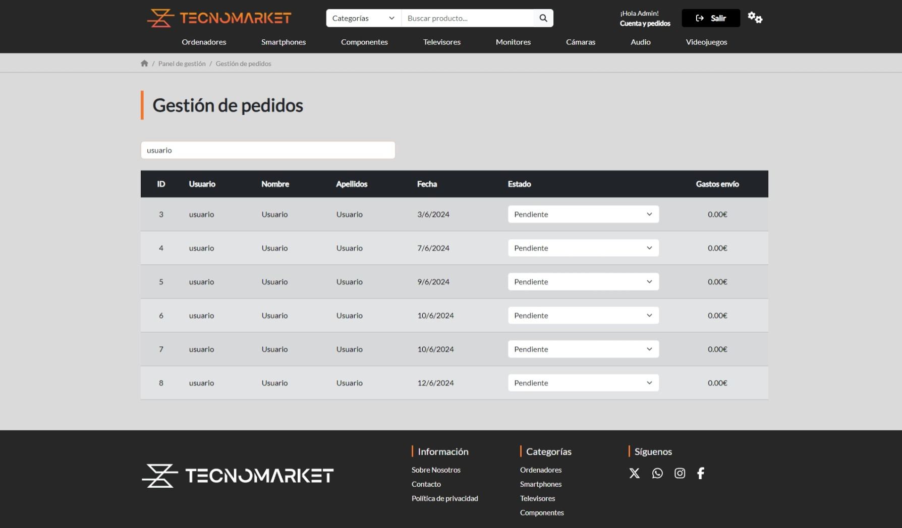
 
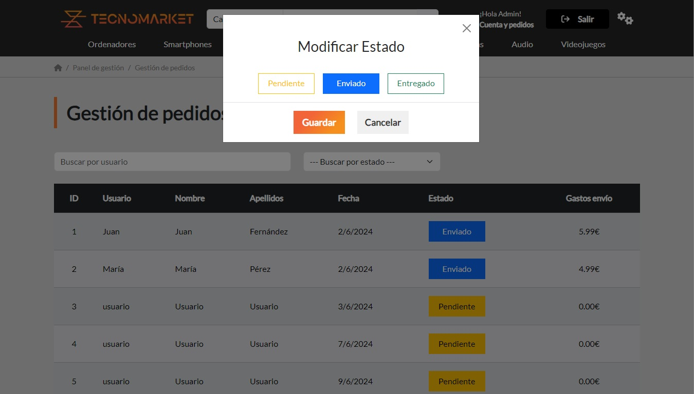
 
## Licencia
 
Consulta el archivo [LICENSE](LICENSE.md) en la raíz del repositorio.
 

 
